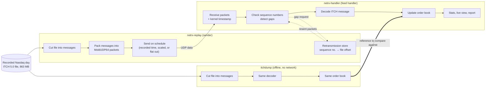
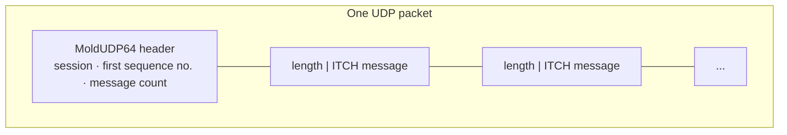
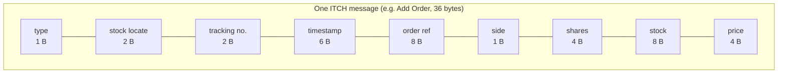
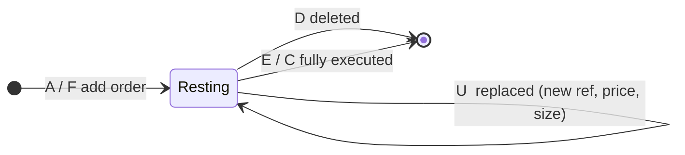
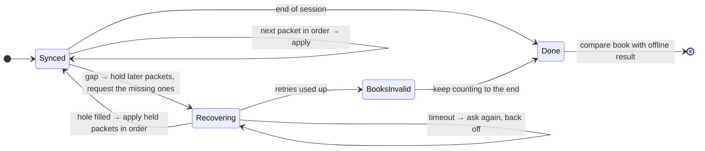
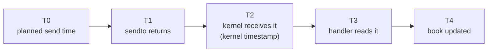

# netrx

**A market data feed handler in C++23, built to be measured honestly.**

Stock exchanges publish every order event (new order, cancel, trade) as a
stream of small binary messages over UDP. A *feed handler* receives that
stream, notices when packets go missing and fetches them again, decodes each
message, and keeps an up-to-date *order book*: every resting order, grouped by
price, for every stock.

netrx builds that whole pipeline end to end, with a full trading day of real
Nasdaq data, and reports how fast each step is. Speed claims always come with
p50, p99, p99.9, max and sample count, plus the machine setup they were
measured on.

## The big picture



There are three programs:

- **The sender** replays the recorded day as network packets, using the same
  packet format Nasdaq uses. It also keeps an index of every message, so it
  can resend any packet the handler asks for again.
- **The feed handler** receives the packets, checks that none are missing,
  decodes each message and updates the order book.
- **The offline tool** reads the file directly, with no network, and runs the
  same decoder and book. Its result is the "known good" answer the live
  handler is checked against.

## The data

The input is Nasdaq BX's full ITCH 5.0 feed for **30 December 2019**:
29,156,757 messages covering 8,906 stocks.

The day is small on average but very bursty. Most of the load comes in the
last minute of trading:

| | |
|---|---|
| Messages in the day | 29.2 million |
| Busiest second | 61,147 messages |
| Busiest millisecond | 1,513 messages, at 16:00:00.003 |
| Most live orders at once | 76,126 |
| Average time per message to clear the busiest millisecond | **661 ns** |

That last number is a throughput target, not a per-message latency budget: 1 ms
divided by 1,513 messages. To clear the busiest millisecond before the next one
starts, receiving, decoding and updating the book has to average about 661 ns
per message.

It is not a latency guarantee, because the messages are not spread evenly over
that millisecond. The busiest 100 µs holds 182 messages (about 549 ns each), and
messages with the same timestamp arrive back to back. A message at the back of
a burst waits for everything ahead of it, so even at an average of 661 ns per
message its queueing delay can approach 1 ms.

## What travels over the wire

Each UDP packet is a **MoldUDP64** packet: a 20-byte header followed by one or
more ITCH messages, each prefixed with its length.





Every message starts with the same 11-byte header. The type byte says what
follows. The file stores messages with the same length-plus-bytes framing, so
the sender copies them into packets without ever decoding them.

## How an order lives in the book

The book only needs a handful of message types. Each one refers to an order
by its reference number:



Other message types, such as trading status or net order imbalance, are
recognised and skipped.

## The decoder

The decoder turns one message's bytes into a typed C++ struct:

1. **Check the size first.** It checks that the message is at least the
   11-byte header and exactly the right length for its type, using a size
   table built at compile time. Anything else is returned as an error through
   `std::expected`. It never reads out of bounds, even on garbage input.
2. **Read the header once**, then switch on the type and call a small function
   for that type.
3. **Return a `std::variant`** of the message structs, with an empty
   alternative for types the book doesn't use.

All fields are big-endian on the wire and are read with one helper
(`memcpy` plus `std::byteswap`). Every struct's size is pinned with a
`static_assert`.

What happens to a bad message depends on where it came from:

- **From the file:** stop and report the byte offset. A corrupt file can't be
  resynced.
- **From the network:** drop the packet and treat it as missing, so gap
  recovery fetches it again.

There are no exceptions on the per-message path.

## Recovering missing packets

UDP can lose packets. Each packet carries the sequence number of its first
message, so the handler knows exactly what's missing:



The goal is that, even with packets deliberately dropped, the live book ends
up identical to the offline one.

## What it measures

Each packet is stamped at several points, so each stage of the delay can be
reported separately:



- **T1 − T0:** how late the sender was
- **T3 − T2:** time spent in the kernel's receive path
- **T4 − T3:** decode plus book update, which must average under 661 ns per
  message to keep up with the busiest millisecond

Latency is measured from the *planned* send time, so a slow sender can't hide
its own delay.

## The order book

Each stock has its own book. A book holds two things:

- **Every resting order**, looked up by its reference number. This is the
  busiest structure in the program: about 14.0 million inserts and 14.0 million
  removals over the day (every order added is gone by the close). Inserts are
  A + F + U = 13,996,869. Removals are D (11,821,540) plus U (1,741,672) plus
  433,657 executes and cancels that empty an order; that last figure is derived
  from live orders ending at 0, not counted.
- **Price levels per side**, meaning the total shares resting at each price, kept
  sorted so the best bid and best ask are at the ends (`std::flat_map`).
  The order table is `RefMap`, my own open-addressing hash map
  (`include/netrx/refmap.hpp`). All entries live in one flat array, so a lookup
  usually touches one or two neighbouring slots instead of following pointers to
  separate heap nodes the way `std::unordered_map` does.

- **Linear probing:** a key starts at its home slot and steps forward to the next
  free one.
- **Key 0 marks an empty slot.** ITCH never uses order reference 0.
- **Backward-shift erase:** when an order is removed, the entries behind it
  slide back to fill the gap, so the table never fills up with "deleted"
  markers. That matters on a day with 14.0 million removals.
- **Growth:** the capacity is always a power of two, and the table doubles when
  it passes half full.
  Swapping it in made the whole day **31% faster** (3.02 s to 2.07 s), with
  identical output. A Google Benchmark replay of the day's 26.7 million real
  order-table operations puts it level with `absl::flat_hash_map` and 2.6x faster
  than `std::unordered_map`. Here an operation is one table-touching message
  (A + F + E + C + X + D + U = 26,748,132): a U counts once even though it
  removes one order and adds another, and E/C/X count even when they only look
  an order up, so it is not the 14.0 million inserts plus 14.0 million removals.
  Details are in `results/phase2-refmap.md` and
  `results/bench/phase2-maps.json`, and before/after flame graphs are in
  `docs/profiles/`.

## Where it stands

**Working today:** the decoder, the order book and the offline tool.
`itchdump` decodes the whole 29.2-million-message day and builds every stock's
book as it goes. Every order is added once, and every cancel, execute, replace
and delete refers to a live order. The number of live orders peaks at exactly
76,126 and returns to 0 at the close, the whole file is consumed, and the day
ends with the closing event. Debug and Release builds give identical results:

```
S 6 R 8906 A 12210139 F 45058 E 578839 C 2686 X 348198 D 11821540 U 1741672 unknown 2399713
total 29156757 live 0 peak 76126 last event 'C'
```

| Version | Release wall time for the whole day |
|---|---|
| Decoder only (phase 1) | 2.92 s |
| Decoder + books on `std::unordered_map` | 3.02 s |
| Decoder + books on `RefMap` | **2.07 s** |

**Being built next:** the sender, the live handler, gap recovery, and finally
running across two machines over a real network link.

## Build and run

You need a C++23 compiler and CMake 3.20 or newer.

The data file is not in the repo. Download `20191230.BX_ITCH_50.gz` from
Nasdaq's public ITCH samples (emi.nasdaq.com, folder `ITCH/Nasdaq BX ITCH/`),
unzip it, and put it at `planning/20191230.BX_ITCH_50`.

```sh
make run-release   # -O3, asserts compiled out  -> build-release/
make run-debug     # -O0 -g, asserts + libstdc++ checks on -> build-debug/
make test          # debug build, Catch2 suite under ASan/UBSan
make bench         # Google Benchmark: order-table maps on the real day -> results/bench/
```
```
`make bench` downloads Google Benchmark and Abseil on first use. Normal builds
never do.

`make debug` / `make release` only build. The Makefile wraps the CMake presets
in `CMakePresets.json`, so `cmake --preset release && cmake --build --preset
release` works too, and CLion picks the presets up automatically.

The debug preset (used by `make debug`, `make run-debug` and `make test`) builds
with `-Wall -Wextra -Wpedantic -Wconversion -Wsign-conversion -Wshadow` (`/W4`
on MSVC), ASan + UBSan, and runs clang-tidy (checks in `.clang-tidy`) on every
source as it compiles. Release and profile keep the warnings but skip the
sanitizers and clang-tidy. Override with `-DNETRX_ENABLE_SANITIZERS=ON|OFF`,
`-DNETRX_ENABLE_CLANG_TIDY=ON|OFF`, `-DNETRX_WARNINGS_AS_ERRORS=ON`; see
`cmake/NetrxBuildOptions.cmake`.

## Where this started

netrx began as a UDP loopback test bench: send a million packets, one every
10 µs, and measure how late and how slow each one was. The main lesson carried
over: **the biggest improvement came from my own code, not a kernel
setting.** A timer started before two large buffers were filled, and the
resulting page faults made the first ~600 packets late. Moving one line cut the
worst case from about 5 ms to under 140 µs. Of the kernel tweaks, busy polling
and full kernel preemption helped, and most others didn't. Raw results are in
`results/`.

## Not in scope

Kernel bypass (DPDK, AF_XDP), trading strategies, sending orders, and
connecting to a real exchange.
