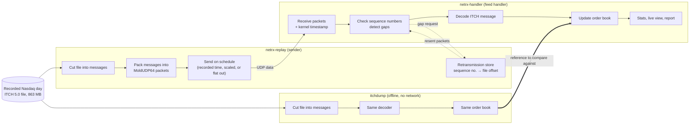
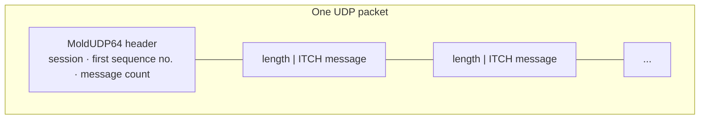
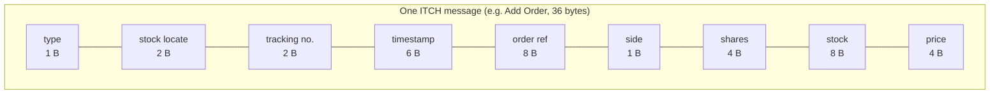
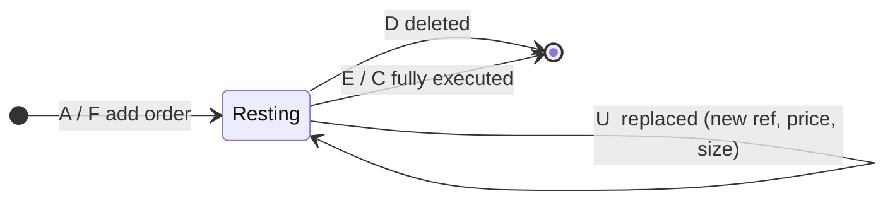
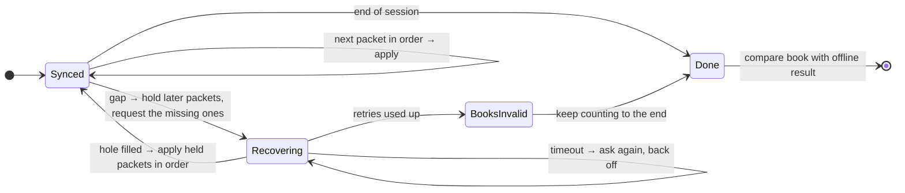
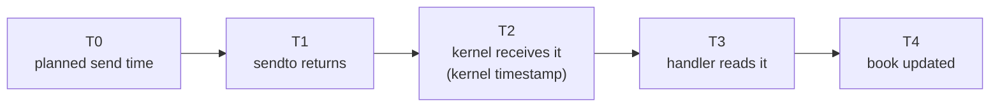

# netrx

**A market data feed handler in C++23, built to be measured honestly.**

Stock exchanges publish every order event (new order, cancel, trade) as a
stream of small binary messages over UDP. A *feed handler* receives that
stream, notices when packets go missing and fetches them again, decodes each
message, and keeps an up-to-date *order book*: every resting order, grouped by
price, for every stock.

netrx builds that whole pipeline end to end, with a full trading day of real
Nasdaq data, and reports how fast each step is. Speed claims always come with
p50, p99, p99.9, max and sample count, plus the machine setup they were
measured on.

## The big picture



There are three programs:

- **The sender** replays the recorded day as network packets, using the same
  packet format Nasdaq uses. It also keeps an index of every message, so it
  can resend any packet the handler asks for again.
- **The feed handler** receives the packets, checks that none are missing,
  decodes each message and updates the order book.
- **The offline tool** reads the file directly, with no network, and runs the
  same decoder and book. Its result is the "known good" answer the live
  handler is checked against.

## The data

The input is Nasdaq BX's full ITCH 5.0 feed for **30 December 2019**:
29,156,757 messages covering 8,906 stocks.

The day is small on average but very bursty. Most of the load comes in the
last minute of trading:

| | |
|---|---|
| Messages in the day | 29.2 million |
| Busiest second | 61,147 messages |
| Busiest millisecond | 1,513 messages, at 16:00:00.003 |
| Most live orders at once | 76,126 |
| Time budget per message in the busiest millisecond | **661 ns** |

That last number is the real target: to keep up at real speed, receiving,
decoding and updating the book has to fit in about 661 ns per message at the
worst moment of the day.

## What travels over the wire

Each UDP packet is a **MoldUDP64** packet: a 20-byte header followed by one or
more ITCH messages, each prefixed with its length.





Every message starts with the same 11-byte header. The type byte says what
follows. The file stores messages with the same length-plus-bytes framing, so
the sender copies them into packets without ever decoding them.

## How an order lives in the book

The book only needs a handful of message types. Each one refers to an order
by its reference number:



Other message types, such as trading status or net order imbalance, are
recognised and skipped.

## The decoder

The decoder turns one message's bytes into a typed C++ struct:

1. **Check the size first.** It checks that the message is at least the
   11-byte header and exactly the right length for its type, using a size
   table built at compile time. Anything else is returned as an error through
   `std::expected`. It never reads out of bounds, even on garbage input.
2. **Read the header once**, then switch on the type and call a small function
   for that type.
3. **Return a `std::variant`** of the message structs, with an empty
   alternative for types the book doesn't use.

All fields are big-endian on the wire and are read with one helper
(`memcpy` plus `std::byteswap`). Every struct's size is pinned with a
`static_assert`.

What happens to a bad message depends on where it came from:

- **From the file:** stop and report the byte offset. A corrupt file can't be
  resynced.
- **From the network:** drop the packet and treat it as missing, so gap
  recovery fetches it again.

There are no exceptions on the per-message path.

## Recovering missing packets

UDP can lose packets. Each packet carries the sequence number of its first
message, so the handler knows exactly what's missing:



The goal is that, even with packets deliberately dropped, the live book ends
up identical to the offline one.

## What it measures

Each packet is stamped at several points, so each stage of the delay can be
reported separately:



- **T1 − T0:** how late the sender was
- **T3 − T2:** time spent in the kernel's receive path
- **T4 − T3:** decode plus book update, which must fit the 661 ns budget

Latency is measured from the *planned* send time, so a slow sender can't hide
its own delay.

## Where it stands

**Working today:** the decoder and the offline tool. `itchdump` decodes the
whole 29.2-million-message day and checks it as it goes. Every order is added
once, every cancel, execute, replace and delete refers to a known order, the
whole file is consumed, and the day ends with the closing event. Debug and
Release builds give identical results:

```
S 6 R 8906 A 12210139 F 45058 E 578839 C 2686 X 348198 D 11821540 U 1741672 unknown 2399713
total 29156757
```

| Build | Wall time for the whole day |
|---|---|
| Release | 2.92 s |
| Debug | 16.37 s |

**Being built next:** the order book, then the sender, the live handler, gap
recovery, and finally running across two machines over a real network link.

## Build and run

You need a C++23 compiler and CMake 3.20 or newer.

The data file is not in the repo. Download `20191230.BX_ITCH_50.gz` from
Nasdaq's public ITCH samples (emi.nasdaq.com, folder `ITCH/Nasdaq BX ITCH/`),
unzip it, and put it at `planning/20191230.BX_ITCH_50`.

```sh
cmake -S . -B build-release -DCMAKE_BUILD_TYPE=Release
cmake --build build-release -j
./build-release/itchdump
```

For the fully checked run with asserts on, use `-DCMAKE_BUILD_TYPE=Debug` and
a `build-debug` folder instead.

## Where this started

netrx began as a UDP loopback test bench: send a million packets, one every
10 µs, and measure how late and how slow each one was. The main lesson carried
over: **the biggest improvement came from my own code, not a kernel
setting.** A timer started before two large buffers were filled, and the
resulting page faults made the first ~600 packets late. Moving one line cut the
worst case from about 5 ms to under 140 µs. Of the kernel tweaks, busy polling
and full kernel preemption helped, and most others didn't. Raw results are in
`results/`.

## Not in scope

Kernel bypass (DPDK, AF_XDP), trading strategies, sending orders, and
connecting to a real exchange.
